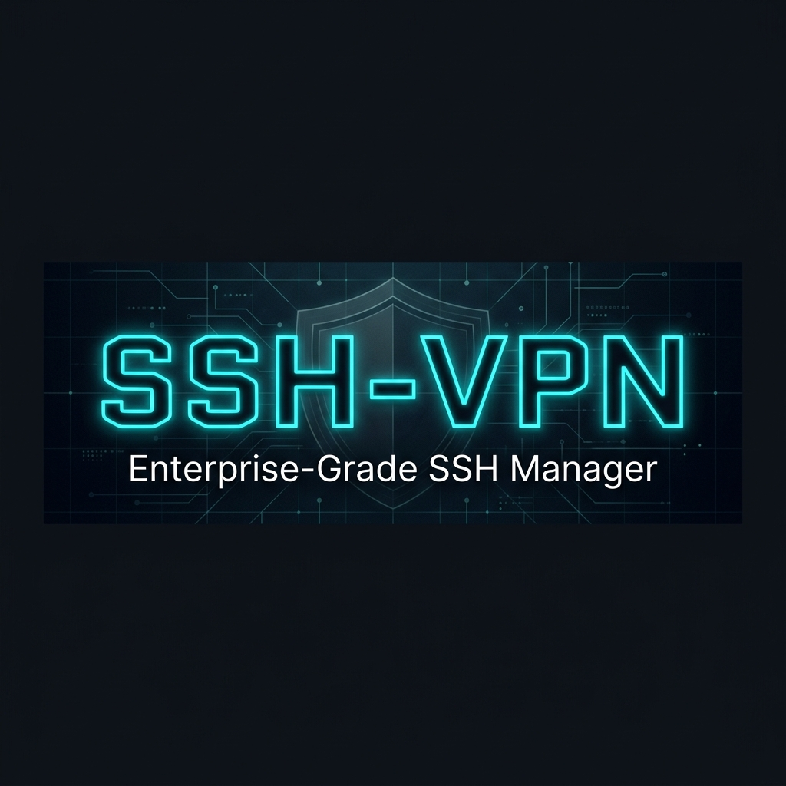

<div dir="rtl">

<div align="center">



# SSH-VPN

**هر سرور لینوکسی را به یک سرور SSH VPN سریع و پایدار تبدیل کنید — با تماس صوتی و تصویری بدون قطعی.**

[English](README.md) · [راهنمای اپ‌ها](docs/CLIENTS.md) · [تغییرات](CHANGELOG.md)

</div>

---

## ⚡ نصب با یک دستور

</div>

```bash
bash <(curl -fsSL https://raw.githubusercontent.com/SandBaad/SSH-VPN/main/scripts/install.sh)
```

<div dir="rtl">

نصب‌کننده فایل اجرایی را دانلود و با checksum بررسی می‌کند، تنظیمات sshd و کرنل را بهینه می‌کند، سرویس را بالا می‌آورد و اگر پورت‌های ۸۰ و ۴۴۳ آزاد باشند، Gateway وب‌سوکت/TLS را روی آن‌ها فعال می‌کند. بعد:

</div>

```bash
sshfortress user add ali --days 30 --limit 2 --traffic 50   # کارت اتصال آمادهٔ ارسال
sshfortress                                                  # پنل ترمینالی
```

<div dir="rtl">

> سیستم‌عامل: Ubuntu 18.04+، Debian 10+، CentOS/Rocky/Alma 7+ · معماری: x86_64، ARM64، ARMv7
> به‌روزرسانی: همان دستور نصب را دوباره اجرا کنید. حذف: `install.sh uninstall` (کاربرها حفظ می‌شوند).
>
> اگر دسترسی به گیت‌هاب کند یا مسدود است، فایل‌ها را روی یک mirror بگذارید و با `SSHVPN_DOWNLOAD_URL=https://mirror/... bash install.sh` نصب کنید.

---

## 🚀 چرا نسخهٔ ۲؟

| مشکل رایج SSH VPN ها | راه‌حل SSH-VPN v2 |
|---|---|
| **تماس تلگرام/واتساپ قطع‌ووصل می‌شود.** sshd برای تونل‌ها `TCP_NODELAY` را روشن نمی‌کند و بسته‌های کوچک صدا منتظر الگوریتم Nagle می‌مانند. | **Gateway** قبل از تحویل سوکت به sshd، `TCP_NODELAY` را روشن می‌کند — بدون کپی و بدون پرش اضافه. |
| **تماس بعد از چند ثانیه قطع می‌شود.** خیلی از نصب‌ها (از جمله نسخهٔ ۱ همین پروژه) badvpn را به ۱۰ جریان UDP محدود می‌کنند و جریان یازدهم، قدیمی‌ترین را — که اغلب خود تماس است — می‌بندد. | **UDPGW داخلی** سازگار با badvpn با ۵۱۲ جریان برای هر کاربر، پاسخ full-cone برای تماس‌های P2P، و حذف بسته به‌جای صف‌کردن وقتی شبکه شلوغ است تا صدا عقب نیفتد. |
| **دانلود سنگین، تماس را هم خراب می‌کند.** | BBR + fq + `tcp_notsent_lowat` و غیرفعال‌کردن slow-start بعد از مکث، با بافرهای متناسب با RAM. |
| **وقتی همه با هم وصل می‌شوند، «Connection refused».** | بالا بردن `MaxStartups`، نرم‌کردن جریمهٔ IP در OpenSSH 9.8+ (که کل کاربران پشت NAT اپراتور را قفل می‌کرد)، keepalive هر ۲۰ ثانیه تا گوشی‌های قطع‌شده سریع جا خالی کنند. |
| **ورود با رمز روی VPS ابری کار نمی‌کند** (فایل `50-cloud-init.conf`). | تنظیمات با فایل `00-` اولویت می‌گیرد — فقط برای کاربران VPN؛ سیاست ورود ادمین دست نمی‌خورد. |
| **IP فیلتر شد / SSH شناسایی شد.** | یک پورت هم‌زمان **SSH، پیلود HTTP، WebSocket و TLS با هر SNI** را می‌فهمد — پشت **Cloudflare CDN** هم کار می‌کند. |
| **محدودیت‌ها واقعاً اعمال نمی‌شوند.** | دیمن محدودیت دستگاه، انقضا (دقیق تا دقیقه) و **حجم ترافیک** را اعمال و همه را ثبت می‌کند. |

---

## ✨ امکانات

- **کاربران:** انقضا، تعداد دستگاه، **سهمیهٔ حجم**، تمدید، قفل/باز، قطع اتصال، تغییر رمز، کارت اتصال آماده
- **تماس و UDP:** UDPGW داخلی روی پورت‌های ۷۱۰۰/۷۲۰۰/۷۳۰۰، نمایش تعداد جریان‌های UDP هر کاربر، watchdog
- **Gateway:** SSH مستقیم، پیلود HTTP و split، `CONNECT`، WebSocket (خام و فریم‌دار)، TLS با هر SNI، IP واقعی پشت CDN
- **مانیتورینگ:** کاربران آنلاین با IP، پروتکل، حجم و **سرعت لحظه‌ای**؛ گزارش رویدادها؛ خروجی `--json`
- **بهینه‌سازی:** BBR، صف ارسال کم‌تأخیر، بافرهای متناسب با RAM؛ بازگشت کامل به تنظیمات اولیه با `optimize reset`
- **امنیت:** کاربران VPN به سرویس‌های داخلی سرور (پنل‌ها، دیتابیس) و پورت ۲۵ (اسپم) دسترسی ندارند؛ هر تغییر sshd با `sshd -t` تست و در صورت خطا برگردانده می‌شود
- **بکاپ و مهاجرت:** بکاپ شامل هش رمزهاست؛ روی سرور جدید restore کنید و همه با رمز قبلی وصل می‌شوند
- **عیب‌یابی:** `sshfortress doctor` مشکل را پیدا می‌کند و راه‌حل را می‌نویسد

---

## 🧭 دستورها

</div>

```bash
sshfortress                                   # پنل ترمینالی (یا: sshf ، menu)
sshfortress user add ali -d 30 -l 2 -t 50     # ۳۰ روز، ۲ دستگاه، ۵۰ گیگ
sshfortress user list                         # وضعیت، آنلاین، انقضا، حجم
sshfortress user info ali                     # کارت + اتصال‌های فعال
sshfortress user renew ali 30 --reset-traffic # تمدید و صفر کردن حجم
sshfortress user expiry ali "2026-12-31 23:59"
sshfortress user passwd ali                   # رمز تصادفی جدید + کارت
sshfortress user traffic ali --set 100        # سهمیه (۰ = نامحدود)
sshfortress user lock ali | unlock ali | kick ali | del ali
sshfortress online -w                         # آنلاین‌ها با سرعت لحظه‌ای
sshfortress status                            # وضعیت اجزا + رویدادهای اخیر
sshfortress doctor                            # عیب‌یابی
sshfortress optimize [status|apply|reset]
sshfortress gateway enable --ports 80,443,8080
sshfortress backup create | list | restore FILE
sshfortress apply                             # اعمال دوبارهٔ config.yaml
```

<div dir="rtl">

---

## 📱 تنظیم اپ‌ها (خلاصه)

| حالت در اپ | سرور / پورت | توضیح |
|---|---|---|
| SSH مستقیم | `server:22` | — |
| SSH روی WebSocket / پیلود | `server:80` | پیلود: `GET / HTTP/1.1[crlf]Host: [host][crlf]Upgrade: websocket[crlf][crlf]` |
| SSH روی SSL/TLS | `server:443` | هر SNI، مثلاً یک دامنهٔ مجاز |
| از طریق Cloudflare | دامنهٔ پروکسی‌شده : 80/443 | ابر نارنجی روشن، حالت SSL روی Full |
| **تماس و بازی** | — | **UDPGW را روی `127.0.0.1:7300` فعال کنید** |

راهنمای کامل هر اپ (HTTP Injector، NPV Tunnel، HTTP Custom، NetMod، Termux): [docs/CLIENTS.md](docs/CLIENTS.md)

---

## ⬆️ ارتقا از نسخهٔ ۱

فقط دستور نصب را دوباره اجرا کنید. تنظیمات، کاربران و داده‌ها حفظ و خودکار منتقل می‌شوند:
کاربران قدیمی به گروه `sshvpn` منتقل می‌شوند، سرویس قدیمی `badvpn-udpgw` با UDPGW داخلی روی همان پورت‌ها جایگزین می‌شود (برگشت: `sshfortress udpgw mode badvpn`) و سرویس خراب قبلی که می‌خواست پنل را روی `tty1` اجرا کند، با دیمن عوض می‌شود.

---

## ❓ سؤال‌های رایج

**تماس وصل نمی‌شود؟** در اپ، UDPGW را روی `127.0.0.1:7300` فعال کنید و `sshfortress doctor` را اجرا کنید.

**پورت ۸۰ یا ۴۴۳ دست وب‌سرور است؟** پورت دیگری بدهید: `sshfortress gateway enable --ports 8080,8443` (برای Cloudflare از پورت‌های 8080/8880/2052/2082/2086/2095 و 2053/2083/2087/2096/8443 استفاده کنید).

**IP سرور فیلتر شد؟** روی سرور جدید نصب کنید و بکاپ را restore کنید: `sshfortress backup restore FILE` — کاربران با همان رمز وصل می‌شوند. یا سرور را پشت Cloudflare ببرید.

**حجم مصرفی چطور حساب می‌شود؟** هر بایتی که از تونل کاربر عبور می‌کند (TCP و UDP، دانلود و آپلود) شمرده می‌شود. وقتی سهمیه تمام شود حساب قفل و اتصال‌ها قطع می‌شوند؛ با `user traffic NAME --reset` یا تمدید با `--reset-traffic` باز می‌شود.

---

## 📄 مجوز

MIT — فایل [LICENSE](LICENSE).

</div>
