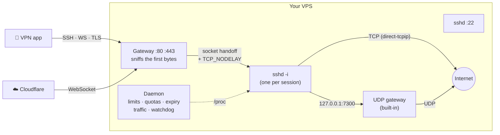

<div align="center">


# SSH-VPN

**Turn any Linux VPS into a fast, stable SSH VPN server — where voice & video calls actually work.**

[](https://github.com/SandBaad/SSH-VPN/actions/workflows/ci.yml)
[](https://github.com/SandBaad/SSH-VPN/releases)
[](https://go.dev)
[](#-install)
[](LICENSE)

[**Install**](#-install) · [**Features**](#-features) · [**Client setup**](docs/CLIENTS.md) · [**راهنمای فارسی**](README.fa.md) · [**Changelog**](CHANGELOG.md)

</div>

---

## ⚡ Install

```bash
bash <(curl -fsSL https://raw.githubusercontent.com/SandBaad/SSH-VPN/main/scripts/install.sh)
```

That's it. The installer downloads a checksum-verified binary, tunes sshd and the kernel, starts the
service and picks the free ports among 80/443 for the WebSocket/TLS gateway. Then:

```bash
sshfortress user add ali --days 30 --limit 2 --traffic 50   # prints a ready-to-send connection card
sshfortress                                                  # terminal UI
```

> Ubuntu 18.04+, Debian 10+, CentOS/Rocky/Alma 7+ · x86_64, ARM64, ARMv7 · root + systemd.
> Update: run the same command again. Remove: `… install.sh uninstall` (users are kept).

---

## 🚀 Why v2

Most SSH-VPN panels are a pile of bash around `sshd` and `badvpn`. They work — until a call
breaks up, a phone reconnects and gets refused, or a user streams 200 GB. v2 is a rewrite of
the parts that decide speed and stability:

| Problem with typical SSH VPNs | What SSH-VPN v2 does |
|---|---|
| **Choppy calls.** `sshd` never enables `TCP_NODELAY` for tunnel-only sessions, so small voice packets wait on Nagle's algorithm. | The **gateway** turns on `TCP_NODELAY` and hands the socket straight to `sshd -i` — no proxy copy, no extra hop. |
| **Calls drop after a few seconds.** Many setups (v1 of this project included) cap badvpn at 10 UDP flows per client; the 11th (say, a DNS lookup) evicts the oldest — often the call. | **Built-in UDP gateway** (badvpn-compatible) with 512 flows/client, full-cone replies for P2P, and drop-instead-of-queue under congestion so audio never lags behind. |
| **Big downloads freeze calls.** Bufferbloat in the kernel send queue. | BBR + fq pacing + `tcp_notsent_lowat` + no slow-start-after-idle, sized to your RAM. |
| **"Connection refused" when many reconnect.** sshd's default `MaxStartups 10:30:100`, and (OpenSSH 9.8+) per-source penalties that lock out whole carrier-NAT ranges. | Raised limits, relaxed penalties, 20 s keepalive so dead phones free their slot fast. |
| **Password logins silently broken** on cloud images (`50-cloud-init.conf` sets `PasswordAuthentication no`). | A `00-` drop-in that wins — scoped to VPN users only; your admin login policy is untouched. |
| **IP blocked / SSH detected.** | One port speaks **SSH, HTTP payload, WebSocket and TLS (any SNI)** — works behind **Cloudflare CDN**. |
| **Limits that don't limit.** | A daemon enforces devices, expiry (to the minute) and **traffic quotas** — and logs every action. |

Everything above was tested end-to-end against a real OpenSSH 9.9 server and the reference
badvpn-udpgw (see [How it was tested](#-how-it-was-tested)).

---

## ✨ Features

<table>
<tr><td width="50%" valign="top">

### 👤 Users
- Create with expiry, device limit, **traffic quota**
- Renew, lock/unlock, kick, change password
- Exact-minute expiry; PAM expiry as a backstop
- Connection card ready to paste to the user
- Kick policy: *oldest* (phones that switch networks reconnect instantly) or *newest*

</td><td width="50%" valign="top">

### 📞 Calls & UDP
- Built-in **UDPGW** on 7100/7200/7300 (badvpn protocol)
- Telegram/WhatsApp calls, games, QUIC, DNS
- Per-session UDP flow counts in the monitor
- Optional external `badvpn-udpgw` mode
- Watchdog restarts it if it stops answering

</td></tr>
<tr><td valign="top">

### 🚪 Gateway (one port, every protocol)
- Raw **SSH**
- **HTTP payload** / split payload / `CONNECT`
- **WebSocket** — raw-after-upgrade *and* real framing
- **TLS/SSL** with any SNI (self-signed or your cert)
- Real client IP from `CF-Connecting-IP` / `X-Forwarded-For`
- Flood protection (MaxStartups for inetd mode)
- Sessions survive daemon restarts and upgrades

</td><td valign="top">

### 📡 Monitoring
- Live sessions: client IP, protocol, traffic, **speed**
- Per-user traffic accounting (TCP + UDP)
- Event log: kicks, expiries, quota locks
- `sshfortress doctor` — finds what's broken and prints the fix
- `--json` on every list command for your own panel/bot

</td></tr>
<tr><td valign="top">

### ⚡ Performance
- BBR + fq, low-latency send queues
- RAM-aware socket buffers, port range, backlogs
- sshd: no DNS lookups, no compression, fast keepalive
- Original values saved — `optimize reset` really restores them

</td><td valign="top">

### 🛡️ Safety
- Firewall: VPN users can't reach services on your server or send SMTP spam
- Every sshd change validated with `sshd -t`, rolled back on error
- No shell for VPN users, no remote port forwarding
- Backups carry password hashes → **move to a new VPS in one command**

</td></tr>
</table>

---

## 🧭 Usage

```bash
sshfortress                          # terminal UI (also: sshf, menu)

# users
sshfortress user add ali -d 30 -l 2 -t 50     # 30 days, 2 devices, 50 GB
sshfortress user list                         # status, online, expiry, traffic
sshfortress user info ali                     # card + live sessions
sshfortress user renew ali 30 --reset-traffic
sshfortress user expiry ali "2026-12-31 23:59"
sshfortress user passwd ali                   # new random password + card
sshfortress user traffic ali --set 100        # quota in GB (0 = unlimited)
sshfortress user lock ali | unlock ali | kick ali | del ali
sshfortress user purge --days 7               # delete long-expired users

# server
sshfortress online -w                # live sessions with speed
sshfortress status                   # components + recent events
sshfortress doctor                   # health check with fixes
sshfortress optimize [status|apply|reset]
sshfortress gateway enable --ports 80,443,8080
sshfortress udpgw mode builtin|badvpn
sshfortress backup create | list | restore FILE
sshfortress apply                    # re-apply config.yaml
```

Add `--json` to `user list`, `user info`, `online`, `status`, `doctor` for scripts and bots.

---

## 📱 Client setup

Full guide with screenshots-worth of detail: **[docs/CLIENTS.md](docs/CLIENTS.md)**. The short version:

| Mode in the app | Server / port | Extra |
|---|---|---|
| SSH direct | `server:22` | — |
| SSH over WebSocket / payload | `server:80` | payload `GET / HTTP/1.1[crlf]Host: [host][crlf]Upgrade: websocket[crlf][crlf]` |
| SSH over SSL/TLS | `server:443` | any SNI, e.g. a whitelisted domain |
| Through Cloudflare | your proxied domain : 80/443 | DNS record proxied (orange cloud), SSL mode *Full* |
| **Calls & games** | — | enable **UDPGW → `127.0.0.1:7300`** |

---

## 🏗️ How it works



- **One process per session, zero copies.** For raw SSH and WebSocket the gateway peeks at the
  first bytes without consuming them, answers the HTTP handshake if there is one, then hands the
  untouched socket to `sshd -i`. TLS and framed WebSocket are decrypted/de-framed and piped through
  a UNIX socket pair.
- **Accounting without iptables tricks.** Each authenticated session is an `sshd` process owned by the
  user; every tunnelled byte passes through its `read()`/`write()` counters in `/proc/<pid>/io`.
  The daemon samples them every few seconds (verified: a 50 MB download counted as 50.03 MB).
- **State on disk, not in RAM.** Users live in BoltDB, opened per operation so the daemon, the TUI
  and the CLI never block each other. Live data is published to `/run/sshfortress/state.json`.

```
cmd/sshfortress     CLI (Cobra)            internal/gateway   SSH/HTTP/WS/TLS front door
internal/daemon     background service     internal/udpgw     badvpn-compatible UDP gateway
internal/session    /proc session scanner  internal/sshd      managed sshd config + validation
internal/user       user lifecycle         internal/netopt    kernel profile with backup
internal/firewall   owner-match rules      internal/doctor    diagnostics
internal/backup     backup / migration     tui/               Bubble Tea terminal UI
```

---

## ⚙️ Configuration

`/etc/sshfortress/config.yaml` — edit, then `sshfortress apply`. Defaults shown:

```yaml
server:
  host: ""                    # domain/IP on connection cards ("" = auto-detect)
ssh:
  ports: [22]
  tuning: true                # keepalive, MaxStartups, no DNS, no compression
  client_alive_interval: 20
  client_alive_count_max: 3
  max_startups: "100:30:1000"
  banner: ""                  # text shown by most VPN apps
udpgw:
  enabled: true
  mode: builtin               # or: badvpn
  ports: [7100, 7200, 7300]
  max_connections_per_client: 512
gateway:
  enabled: true               # set by the installer when 80/443 are free
  ports: [80, 443]
  tls_cert: ""                # empty = self-signed (fine for apps and Cloudflare "Full")
  tls_key: ""
limiter:
  enabled: true
  policy: oldest              # kick the oldest session when over the limit
  interval_secs: 5
network:
  auto_optimize: true
  congestion_control: bbr
firewall:
  enabled: true
  block_local: true           # VPN users can't reach 127.0.0.1 services
  block_smtp: true
  allow_local_ports: []
user_defaults:
  default_expiration_days: 30
  default_max_connections: 2
  default_traffic_gb: 0       # 0 = unlimited
```

---

## ⬆️ Upgrading from v1

Run the installer again. Your config, users and data are kept and migrated automatically:

- v1 users are moved into the `sshvpn` group (needed for the sshd rules and the firewall).
- The old `badvpn-udpgw` service is retired in favour of the built-in gateway on the same ports
  (switch back any time: `sshfortress udpgw mode badvpn`).
- The broken v1 `sshfortress.service` (which tried to run the UI on `tty1`) is replaced by the daemon.

---

## 🔬 How it was tested

Unit tests run in CI with `-race`. In addition, v2 was exercised end-to-end against a real
**OpenSSH 9.9** server:

- tunnels through direct sshd, gateway raw SSH, WebSocket (CDN header → real IP) and TLS with SNI;
- UDP through the SSH tunnel into the built-in UDPGW (100/100 datagrams echoed), and the same
  client test suite passed against the **reference badvpn-udpgw**;
- device limit (oldest session kicked), exact-minute expiry, traffic quota (locked + kicked +
  login refused), firewall (local service blocked for VPN users only);
- daemon restart with live gateway sessions (they survive), backup → delete → restore → login
  with the original password;
- sshd config validated with `sshd -t` in drop-in and inline mode, and removed byte-for-byte on uninstall.

---

## 🤝 Contributing

```bash
git clone https://github.com/SandBaad/SSH-VPN.git && cd SSH-VPN
make test          # go test -race ./...
make build         # ./build/sshfortress
SSHD_BIN=/usr/sbin/sshd sudo -E go test ./internal/sshd   # validate configs against your sshd
UDPGW_REF_BIN=/usr/local/bin/badvpn-udpgw go test ./internal/udpgw   # differential test
```

Issues and pull requests are welcome. Please run `gofmt` and `go vet` first.

## 📄 License

MIT — see [LICENSE](LICENSE).
